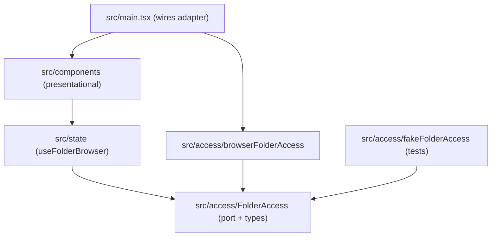

# Architecture Spine — Web File Commander

## Design Paradigm

Ports and adapters. The UI never touches the browser's folder API. It talks to a state owner, which talks to a `FolderAccess` port. A browser adapter implements the port in the app; a fake adapter implements it in tests.



Dependencies point only along these arrows. `components` never import from `access`; only `main.tsx` and tests choose an adapter.

## Invariants & Rules

### AD-1 — Browser folder picker is the access mechanism; Chromium only in v2 [ADOPTED]

- **Binds:** FR-1, FR-3, FR-5, FR-6
- **Prevents:** Mixing two access mechanisms (picker and `<input webkitdirectory>`) with different denial and loading behavior.
- **Rule:** Folder access uses `window.showDirectoryPicker` and the directory handles it returns, in read mode only. No fallback for other browsers. If `showDirectoryPicker` is missing, the app shows a clear "browser not supported" message and nothing else breaks. [ASSUMPTION A1: the message text and placement are not in the UX document yet.]

### AD-2 — Only `src/access/` touches browser file APIs, behind a read-only port [ADOPTED]

- **Binds:** all
- **Prevents:** UI or state code calling handles directly, which makes it untestable and lets write calls creep in.
- **Rule:** `FolderAccess` exposes read operations only: choose a folder, list a folder's entries. It exposes no write, delete, or move operation. Nothing outside `src/access/` references `showDirectoryPicker`, `FileSystemDirectoryHandle`, or `FileSystemFileHandle`.

### AD-3 — Plain types cross the boundary; handles stay opaque

- **Binds:** FR-2, FR-3, FR-6
- **Prevents:** Two units inventing different entry shapes, or the UI depending on the handle's API.
- **Rule:** The port returns `Entry = { name: string; kind: 'file' | 'folder' }` and an opaque `FolderRef`. State and UI store and pass `FolderRef` without reading it. Only the access layer turns a `FolderRef` back into a handle. The port returns entries unsorted.

### AD-4 — The access layer maps every failure to one typed result

- **Binds:** FR-4, FR-5
- **Prevents:** Some paths showing Access Denied while others crash or stay stuck on Loading.
- **Rule:** Port calls return `{ status: 'ok', ... }` or `{ status: 'denied' }` and never throw to callers. Permission refusal (`NotAllowedError`, `SecurityError`) and any other read failure both map to `denied`, since the PRD says "refused, for any reason". A user cancelling the folder picker (`AbortError`) maps to `{ status: 'cancelled' }`, which changes nothing and shows no message. [ASSUMPTION A2: cancel is not a denial.]

### AD-5 — One state owner, three actions, a path stack for Back

- **Binds:** FR-1, FR-2, FR-3, FR-4, FR-5, FR-6
- **Prevents:** Components keeping their own folder state and drifting from the status bar or the File List.
- **Rule:** `useFolderBrowser` in `src/state/` is the only place that holds folder state: the stack of `FolderRef`s from the originally chosen folder to the Selected Folder, the status (`idle | loading | loaded | empty | denied`), and the entries. Components only read it and call `selectFolder`, `openFolder(entry)`, `goBack`. Back is available only when the stack has more than one item, so the originally chosen folder is the top. The status bar text is derived from this state, never set separately.

### AD-6 — The latest request wins

- **Binds:** FR-4, FR-1, FR-3, FR-6
- **Prevents:** A slow earlier load overwriting a newer one, or the Loading Indicator staying on forever.
- **Rule:** Each load carries a request number. A result whose number is not the latest is ignored. Status goes to `loading` when a load starts and leaves it only for the latest request.

### AD-7 — Sorting happens in the state layer

- **Binds:** FR-2
- **Prevents:** The access layer and UI both sorting, or ordering differing between real and fake adapters.
- **Rule:** `src/state/` sorts entries once: subfolders first, then files, each alphabetical by name. Adapters and components never sort. [ASSUMPTION A3: this follows UX assumption U5; PRD Open Question 2 is still open.]

### AD-8 — Tests inject a fake `FolderAccess`

- **Binds:** SM-1, FR-1 to FR-6
- **Prevents:** Tests depending on a real browser picker, or each test faking folders differently.
- **Rule:** `App` receives its `FolderAccess` by prop or context; `main.tsx` supplies the browser adapter. Tests supply `fakeFolderAccess`, an in-memory folder tree with configurable delay and a configurable denial. No test calls the real browser API. This realizes the three tests in `docs/requirements.md` (3 files and 2 subfolders, a loading delay, a denial).

## Consistency Conventions

| Concern | Convention |
| --- | --- |
| Naming | Components in PascalCase files with a default export function component; hooks start with `use`; the port is `FolderAccess`; adapters are `browserFolderAccess` and `fakeFolderAccess`. |
| Data and formats | `Entry` and `FolderRef` as in AD-3. Status values exactly as in AD-5. |
| Errors | No thrown errors cross the port (AD-4). |
| Tests | `*.test.tsx` next to the code, run with Vitest and jsdom (existing convention in `AGENTS.md`). |
| Styling | Plain CSS with the tokens in `DESIGN.md`. |
| Scope | Read-only. No write capability anywhere (AD-2). |

## Stack

Versions are the installed ones from `package.json` / `npm ls` on 2026-10-25.

| Name | Version |
| --- | --- |
| React, React DOM | 19.3.1 |
| TypeScript | 6.0.3 |
| Vite | 8.3.5 |
| Vitest | 5.0.5 |
| jsdom | 29.1.1 |
| @testing-library/react | 16.3.3 |
| ESLint, typescript-eslint | 10.13.0, 8.72.0 |
| Browser target | Chrome 86+ and Edge 86+ (folder picker support per web.dev; Firefox and Safari not supported) |

## Structural Seed

```text
src/
  main.tsx                  # wires browserFolderAccess into App
  App.tsx                   # existing layout; takes FolderAccess
  access/
    FolderAccess.ts         # port, Entry, FolderRef, result types
    browserFolderAccess.ts  # real adapter
    fakeFolderAccess.ts     # in-memory adapter for tests
  state/
    useFolderBrowser.ts     # state owner, sorting, request numbering
  components/               # presentational pieces of the File List, header button, Back
```

No backend. The app is static files served over a secure context. [ASSUMPTION A4: the folder picker needs HTTPS or localhost; not verified for this run.]

## Capability → Architecture Map

| Capability | Lives in | Governed by |
| --- | --- | --- |
| FR-1 Select a Folder | `access/` choose, `state/` selectFolder | AD-1, AD-2, AD-4, AD-5 |
| FR-2 Display Entries | `state/` entries + sort, `components/` | AD-3, AD-7 |
| FR-3 Open a subfolder | `state/` openFolder | AD-3, AD-5, AD-6 |
| FR-4 Loading Indicator | `state/` status, `components/` | AD-5, AD-6 |
| FR-5 Access-Denied Message | `access/` mapping, `state/` status | AD-4, AD-5 |
| FR-6 Go back | `state/` path stack | AD-5, AD-6 |
| SM-1 Acceptance tests | `access/fakeFolderAccess.ts` | AD-8 |

## Deferred

- Hosting and deployment: not needed for a homework project; revisit if the app is published.
- Support for Firefox and Safari (a fallback adapter would fit behind the port): not in v2.
- Remembering the last folder across page reloads (stored handles and permission re-prompts): not in the PRD.
- Very large folders (virtual lists, chunked loading): not required by the PRD; revisit if real folders feel slow.
- Folder Tree and Preview panels: placeholders in v2.
